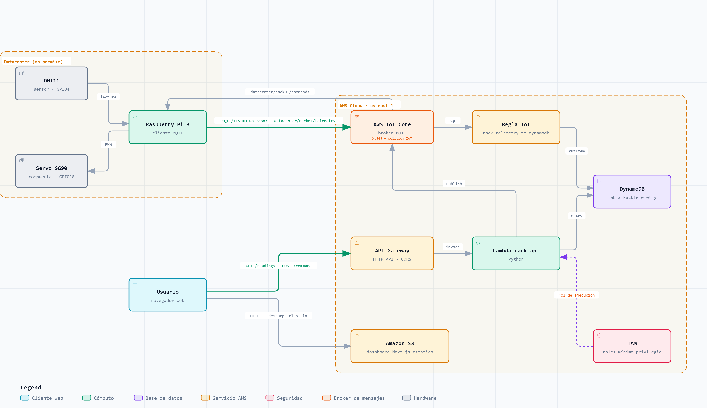

# Monitor de Racks de TI — Arquitectura Serverless para IoT

**Especialización en Inteligencia Artificial · IA aplicada a Internet de las Cosas**
Práctica 3 — Arquitectura Serverless para IoT · Jhorman A. Villanueva Vivas

Sistema de monitoreo de **temperatura y humedad** en racks de un datacenter, con control remoto de una
**compuerta de ventilación**. Una Raspberry Pi lee un sensor DHT11, publica la telemetría por **MQTT**
hacia **AWS IoT Core**, los datos se almacenan en **DynamoDB** y se visualizan en un **dashboard Next.js**
alojado en **Amazon S3**, desde el cual también se acciona el servo y se descargan los datos en CSV.

---

## Tabla de contenido

1. [Caso de uso](#1-caso-de-uso)
2. [Arquitectura](#2-arquitectura)
3. [Estructura del repositorio](#3-estructura-del-repositorio)
4. [Hardware y conexiones](#4-hardware-y-conexiones)
5. [Paso a paso de la implementación](#5-paso-a-paso-de-la-implementación)
6. [Contratos: tópicos MQTT y API](#6-contratos-tópicos-mqtt-y-api)
7. [Verificación de los criterios de evaluación](#7-verificación-de-los-criterios-de-evaluación)
8. [Seguridad y mejoras futuras](#8-seguridad-y-mejoras-futuras)

---

## 1. Caso de uso

En un datacenter, la temperatura y la humedad del aire que entra a los racks determinan la vida útil y la
estabilidad de los equipos. Las recomendaciones de **ASHRAE** para equipos de TI sitúan la temperatura de
entrada entre **18 y 27 °C** y una humedad moderada: con humedad muy baja aumenta la electricidad estática;
con humedad muy alta, el riesgo de condensación y corrosión.

**Solución planteada:**

- Un sensor por rack mide temperatura y humedad cada 10 segundos.
- Los operadores del NOC ven el estado en tiempo real y el histórico en un dashboard web.
- Si un rack se calienta, el operador abre remotamente la **compuerta de ventilación (damper)** del rack
  para dirigirle más aire frío. En este prototipo la compuerta se simula con un **servo SG90** (0° cerrada, 180° abierta).
- Los datos se pueden exportar a CSV para análisis posterior (auditorías, modelos predictivos, etc.).

| Variable | Normal | Advertencia | Crítico |
|---|---|---|---|
| Temperatura | 18 – 27 °C | 27 – 32 °C | < 18 o > 32 °C |
| Humedad relativa | 20 – 60 % | 60 – 80 % | < 20 o > 80 % |

> El montaje se realizó en casa; el contexto de datacenter es el escenario de diseño de la solución.

---

## 2. Arquitectura



*Para regenerar el diagrama: edita `docs/arquitectura.json` y ejecuta `node docs/generar_diagrama.mjs` (requiere la skill archify y Chrome/Edge); se actualizan `docs/arquitectura.png` y la versión interactiva `docs/arquitectura.html`.*

### Flujo de datos

**Telemetría (subida):**

1. La Raspberry Pi despierta al **DHT11** por GPIO4 y decodifica su respuesta (40 bits: humedad, temperatura y checksum).
2. Arma un JSON y lo **publica por MQTT** (QoS 1) en `datacenter/rack01/telemetry`, sobre **TLS mutuo** en el puerto 8883.
3. **AWS IoT Core** autentica el certificado X.509 del dispositivo y autoriza cada acción según su **política IoT**.
4. Una **regla IoT** (`SELECT *, timestamp() AS received_at FROM 'datacenter/+/telemetry'`) escribe cada mensaje en **DynamoDB**.
5. El **dashboard** (navegador) consulta `GET /readings` en **API Gateway**, que invoca una **Lambda** que lee DynamoDB.

**Comandos (bajada):**

1. El operador mueve la compuerta en el dashboard → `POST /command` → **Lambda** → `iot-data:Publish` en `datacenter/rack01/commands`.
2. IoT Core entrega el mensaje a la Raspberry por la **misma conexión MQTT** que ella abrió (no se abren puertos en la red local).
3. La Raspberry mueve el servo por PWM (GPIO18) y publica inmediatamente su nuevo estado (`damper_angle`) como confirmación.

### ¿Por qué serverless?

No hay servidores que administrar: cada servicio escala solo y se cobra por uso. Para el volumen de esta
práctica, todo cabe en la capa gratuita de AWS.

| Servicio | Rol en la solución |
|---|---|
| **AWS IoT Core** | Broker MQTT administrado, autenticación por certificados X.509 y autorización por políticas |
| **Reglas de IoT** | Enrutan los mensajes MQTT a otros servicios mediante SQL |
| **Amazon DynamoDB** | Base de datos NoSQL de la telemetría (clave `device_id` + `ts`) |
| **AWS Lambda** | Lógica de la API: consultar lecturas y publicar comandos |
| **Amazon API Gateway** | Expone la Lambda como API HTTP pública con CORS |
| **Amazon S3** | Aloja el dashboard como sitio web estático |
| **AWS IAM** | Roles y políticas de mínimo privilegio entre servicios |

---

## 3. Estructura del repositorio

```
rack-monitor/
├── README.md
├── docs/
│   └── arquitectura.png         # diagrama de arquitectura
├── device/                      # código de la Raspberry Pi (Python 3.12 + uv)
│   ├── pyproject.toml / uv.lock
│   ├── .env.example
│   ├── test_dht.py              # prueba aislada del sensor
│   ├── test_servo.py            # prueba aislada del servo
│   ├── systemd/rack-device.service
│   └── src/rack_device/
│       ├── dht11.py             # decodificador del protocolo DHT11 sobre pigpio
│       └── main.py              # cliente MQTT: telemetría + comandos
├── lambda/
│   └── lambda_function.py       # API: GET /readings y POST /command
└── dashboard/                   # Next.js (App Router) exportado como sitio estático
```

> `device/certs/` y los archivos `.env` están excluidos en `.gitignore`: **nunca** se suben al repositorio.

---

## 4. Hardware y conexiones

**Materiales:** Raspberry Pi 3, sensor DHT11, servo TowerPro SG90 y cables dupont.

> La guía de la práctica propone un ESP32; se usó una Raspberry Pi 3 porque era el hardware disponible.
> La arquitectura en la nube es idéntica: cualquier dispositivo que hable MQTT con TLS mutuo se integra igual.

| Componente | Cable | Pin físico | Función |
|---|---|---|---|
| DHT11 | VCC | 1 | 3.3 V |
| DHT11 | DATA | 7 | **GPIO4** |
| DHT11 | GND | 9 | Tierra |
| Servo SG90 | Rojo | 2 | 5 V |
| Servo SG90 | Marrón | 6 | Tierra |
| Servo SG90 | Amarillo | 12 | **GPIO18** (PWM por hardware) |

**Control del servo:** PWM a 50 Hz. El ancho del pulso define el ángulo: ~600 µs = 0°, ~1500 µs = 90°, ~2400 µs = 180°.

---

## 5. Paso a paso de la implementación

### 5.1 Registrar el dispositivo en AWS IoT Core (consola, región `us-east-1`)

1. **Política IoT** `rack01-policy` (mínimo privilegio):
   - `iot:Connect` solo con client ID `rack01`.
   - `iot:Publish` solo en `datacenter/rack01/telemetry`.
   - `iot:Subscribe` / `iot:Receive` solo en `datacenter/rack01/commands`.

   ```json
   {
     "Version": "2012-10-17",
     "Statement": [
       { "Effect": "Allow", "Action": "iot:Connect",
         "Resource": "arn:aws:iot:REGION:ACCOUNT_ID:client/rack01" },
       { "Effect": "Allow", "Action": "iot:Publish",
         "Resource": "arn:aws:iot:REGION:ACCOUNT_ID:topic/datacenter/rack01/telemetry" },
       { "Effect": "Allow", "Action": "iot:Subscribe",
         "Resource": "arn:aws:iot:REGION:ACCOUNT_ID:topicfilter/datacenter/rack01/commands" },
       { "Effect": "Allow", "Action": "iot:Receive",
         "Resource": "arn:aws:iot:REGION:ACCOUNT_ID:topic/datacenter/rack01/commands" }
     ]
   }
   ```
2. **Objeto (Thing)** `rack01` → certificado generado automáticamente → adjuntar la política.
3. Descargar el **certificado del dispositivo**, la **llave privada** (solo se puede descargar una vez) y la **Amazon Root CA 1**.
4. Obtener el endpoint de datos:
   ```bash
   aws iot describe-endpoint --endpoint-type iot:Data-ATS
   ```

### 5.2 Preparar la Raspberry Pi

```bash
# Daemon de pigpio: controla los GPIO con temporización precisa (DMA)
sudo apt update && sudo apt install -y pigpio
sudo systemctl enable --now pigpiod

# Proyecto con uv y su propio Python 3.12 (el sistema conserva su Python 3.7)
git clone <este-repo> ~/rack-monitor && cd ~/rack-monitor/device
uv python install 3.12
uv sync

# Certificados y configuración
mkdir -p certs        # copiar aquí device.pem.crt, private.pem.key y AmazonRootCA1.pem
chmod 600 certs/private.pem.key
cp .env.example .env  # completar AWS_IOT_ENDPOINT
```

Pruebas de hardware por separado:

```bash
uv run test_servo.py   # el servo recorre 0° → 90° → 180° → 90° → 0°
uv run test_dht.py     # imprime 5 lecturas de temperatura y humedad
```

### 5.3 Ejecutar el cliente MQTT

```bash
uv run python -m rack_device.main
```

**Puntos clave de `main.py`:**

- **paho-mqtt** con TLS mutuo (`tls_set` con CA, certificado y llave privada), `client_id = rack01`, keepalive de 60 s.
- `loop_start()` maneja la red en un hilo aparte: envío, `PUBACK`, pings del keepalive y **reconexión automática con backoff exponencial** (1 s → 60 s).
- La suscripción a comandos se hace en `on_connect`, así se restablece en cada reconexión.
- Un `threading.Event` evita publicar antes de recibir el `CONNACK`.
- **QoS 1** en telemetría y comandos: cada mensaje se confirma; si la conexión cae, los mensajes quedan en cola.
- Al recibir un comando, mueve el servo y **publica el nuevo estado de inmediato** como confirmación.

**Como servicio del sistema** (arranca al encender y se reinicia si falla):

```bash
sudo cp systemd/rack-device.service /etc/systemd/system/
sudo systemctl daemon-reload
sudo systemctl enable --now rack-device
journalctl -u rack-device -n 30 --no-pager
```

### 5.4 Infraestructura serverless (DynamoDB, regla, Lambda, API, S3)

Recursos creados con la AWS CLI desde **CloudShell** (región `us-east-1`):

| Recurso | Detalle |
|---|---|
| Tabla `RackTelemetry` | Partición `device_id` (S), ordenación `ts` (N), modo `PAY_PER_REQUEST` |
| Rol `iot-dynamodb-rack-role` | IoT Core puede hacer `dynamodb:PutItem` solo en esa tabla |
| Regla `rack_telemetry_to_dynamodb` | Acción DynamoDBv2: cada campo del JSON se guarda como atributo |
| Rol `rack-api-role` | Lambda: `dynamodb:Query` en la tabla + `iot:Publish` en `datacenter/*/commands` |
| Lambda `rack-api` | Python 3.12, código en [`lambda/lambda_function.py`](lambda/lambda_function.py) |
| HTTP API `rack-api` | Integración proxy con la Lambda, CORS restringido al dashboard |
| Bucket `rack-monitor-dashboard-<cuenta>` | Alojamiento web estático con lectura pública |

Actualizar el código de la Lambda:

```bash
cd lambda && zip function.zip lambda_function.py
aws lambda update-function-code --function-name rack-api --zip-file fileb://function.zip
```

### 5.5 Dashboard (Next.js)

```bash
cd dashboard
cp .env.example .env.local   # NEXT_PUBLIC_API_URL=<URL de la API>
npm install
npm run dev                  # desarrollo en http://localhost:3000
npm run build                # genera out/ (sitio estático)
```

`next.config` usa `output: 'export'`: el build produce HTML, CSS y JS estáticos, sin servidor Node.
Todas las llamadas a la API se hacen desde el navegador.

**Funcionalidades:** KPIs con estados por umbral ASHRAE, gráficas históricas (1 h / 6 h / 24 h / 7 d),
actualización automática, control de la compuerta con visualización animada y confirmación,
y descarga de los datos en CSV.

Más detalles en [`dashboard/README.md`](dashboard/README.md).

### 5.6 Despliegue en S3

```bash
aws s3 sync dashboard/out/ s3://rack-monitor-dashboard-<cuenta> --delete
```

URL: `http://rack-monitor-dashboard-<cuenta>.s3-website-us-east-1.amazonaws.com`

---

## 6. Contratos: tópicos MQTT y API

### Tópicos MQTT

| Tópico | Publica | Suscrito | Payload |
|---|---|---|---|
| `datacenter/rack01/telemetry` | Raspberry Pi | Regla IoT → DynamoDB | `{"device_id":"rack01","ts":1793992827648,"temperature":28,"humidity":38,"damper_angle":0}` |
| `datacenter/rack01/commands` | Lambda (desde el dashboard) | Raspberry Pi | `{"damper_angle":90}` |

`ts` es epoch en milisegundos (hora de la lectura). La regla agrega `received_at` (hora de llegada a AWS).

### API HTTP

| Método y ruta | Descripción | Respuesta |
|---|---|---|
| `GET /readings?device_id=rack01&hours=1` | Lecturas del rango (máx. 168 h), orden ascendente por `ts` | `200` con un arreglo de lecturas |
| `POST /command` con body `{"device_id":"rack01","damper_angle":90}` | Publica el comando (0–180) | `200 {"ok":true,...}` o `400 {"error":...}` |

---

## 7. Verificación de los criterios de evaluación

**Funcionalidad: datos en la base de datos**

```bash
aws dynamodb query --table-name RackTelemetry \
  --key-condition-expression "device_id = :d" \
  --expression-attribute-values '{":d":{"S":"rack01"}}' \
  --no-scan-index-forward --limit 3
```

**Comunicación: conexión MQTT estable**

- Cliente de prueba MQTT de la consola de IoT Core suscrito a `datacenter/#`: llega un mensaje cada 10 s.
- La diferencia `received_at - ts` mide la latencia Raspberry → AWS (≈ 50 ms en las pruebas).
- Ante cortes de red, paho reconecta con backoff, se re-suscribe y envía los mensajes QoS 1 en cola.
- `systemd` reinicia el proceso si falla y lo inicia al encender la Raspberry.

**Dashboard**

- Monitoreo en vivo de temperatura y humedad, histórico y estados de alerta.
- Control remoto del actuador con confirmación del estado real del dispositivo.
- Descarga de los datos en CSV.

---

## 8. Seguridad y mejoras futuras

**Implementado:**

- Autenticación del dispositivo con **certificado X.509** y TLS mutuo.
- **Mínimo privilegio** en la política IoT y en los roles IAM de la regla y la Lambda.
- Validación de `device_id` y del ángulo en la Lambda (no se puede publicar en tópicos arbitrarios).
- Certificados y configuración local fuera del repositorio.
- CORS de la API restringido al origen del dashboard.

**Mejoras para producción:**

- **CloudFront** delante de S3 para servir el dashboard por **HTTPS** con dominio propio.
- **Amazon Cognito** (o autorizador JWT en API Gateway) para que solo operadores autenticados controlen la compuerta.
- **Device Shadow** para sincronizar el estado deseado/reportado del actuador aunque el dispositivo esté desconectado.
- **TTL en DynamoDB** para expirar datos antiguos y **alarmas** (SNS / CloudWatch) cuando se superen umbrales críticos.
- Provisionamiento por flota (Fleet Provisioning) para registrar muchos racks.
- Infraestructura como código con **AWS CDK** o **Terraform** y despliegue automático (CI/CD).
